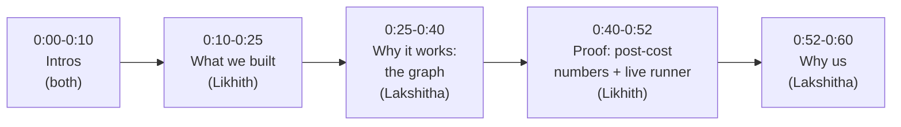

# AYVID — 60-Second YC Founder Video Script

> Companion artifact to [`COMPANY_POSITIONING.md`](./COMPANY_POSITIONING.md).
> YC S26 · AI-Native Hedge Funds RFS (Charlie Holtz).
>
> **Format rule (from YC):** Do **NOT** recite. These are bullets for a card next to the camera. Speak spontaneously, as you would to a friend. Both founders on screen the entire 60 seconds.

---

## Structure at a glance



---

## The bullets (what goes on the card)

### 0:00 – 0:10 — Intros *(both speak, one sentence each)*

- **Likhith:** "Hey YC — I'm Likhith. I authored the full autonomy-system design and proposal for EXO Drones' autonomous firefighting platform — mission logic, flight control, perception, the whole architecture."
- **Lakshitha:** "I'm Lakshitha — Data Science Consulting intern at MathCo, currently on the Interstate Batteries project doing applied ML. Co-founder on AYVID."
- **Together:** "We're AYVID — applying to the AI-Native Hedge Funds RFS."

### 0:10 – 0:25 — What we're doing *(Likhith)*

- "AYVID is literally the fund Charlie described: **swarms of LLM agents reading 10-Ks, earnings calls, and SEC filings, and routing real orders into Interactive Brokers** — no humans on the trade path."
- "Four-agent LangGraph debate — Strategist, Mapper, Auditor, Supervisor — plus a Bull/Bear researcher stage and a vision-LLM PatternAgent reading charts."
- "C++ kill switch at 10 Hz watching the Python process. Production, not a notebook."

### 0:25 – 0:40 — Why it actually works: the graph *(Lakshitha)*

- "Everyone else applying is ChatGPT picks stocks. **Our edge is a Neo4j supply-chain graph.** When a shock hits — Suez, Red Sea, SVB — we trace the N-th order victims **before the market prices them in.**"
- "GPT-4o mines 10-Ks to *discover* new supplier edges, and CausalFusion validates every one against return data with conditional-independence tests. The graph grows and prunes itself — we don't hand-curate it."
- "That's the alpha. It's the graph, not the prompt."

### 0:40 – 0:52 — Proof *(Likhith)*

- "Post-cost walk-forward, 2018 to 2025, IBKR-Tiered commissions + slippage."
- "**Naive baseline: minus 99.98%. Graph-aware: plus 43.65%. A 144-point swing from the graph alone.**"
- "We publish the minus-99.98% control on purpose — that's the honest quant move."
- "Live IB-Paper runner has been writing an equity curve every cycle **since April 19**."

### 0:52 – 0:60 — Why us *(Lakshitha)*

- "I do production ML for Fortune-500 clients; Likhith has shipped hard autonomy-system designs under contract."
- "Big funds couldn't get ChatGPT past compliance. We're not retrofitting AI — we **built the fund AI-native from day zero.**"
- "Thanks for watching."

---

## Delivery notes (don't read these on camera)

- **Energy split:** Likhith = technical builder cadence (short, concrete). Lakshitha = thesis cadence (clear, slightly slower). Alternate so the viewer never goes more than ~15s on one face.
- **No jargon that isn't explained in the same sentence.** "LangGraph" is fine because "four-agent debate" explains it. "Neo4j supply-chain graph" is fine because "trace N-th order victims" explains it.
- **The one number that must land: −99.98% → +43.65%.** Say it slowly. That's the whole pitch.
- **Do NOT say** "AI-powered", "revolutionary", or "disrupting". Say what it does.
- **Do NOT** demo the product, share-screen, or show the dashboard — YC explicitly says the founder video is **just the founders talking.** The demo goes in the separate demo slot.
- **Single take, webcam quality is fine.** Polished ≠ better here.
- **If you blow a line, keep going.** YC is evaluating communication, not editing.

---

## One-shot timing card (print this, tape it next to the camera)

```
0:00 L:   EXO Drones autonomy proposal, authored solo
0:05 LK:  MathCo DS — Interstate Batteries project, co-founder
0:08 BOTH: "We're AYVID — AI-Native Hedge Funds RFS"

0:10 L:   Fund Charlie described — swarms read filings, trade IB
0:18 L:   4-agent LangGraph + Bull/Bear + Vision PatternAgent
0:22 L:   C++ kill switch. Production.

0:25 LK:  Everyone else = ChatGPT picks stocks
0:29 LK:  Our edge = Neo4j supply-chain graph → N-th order victims
0:35 LK:  GPT-4o discovers edges from 10-Ks, CausalFusion validates
0:38 LK:  "It's the graph, not the prompt"

0:40 L:   2018-2025, post-cost, IBKR-Tiered
0:44 L:   Naive -99.98%   →   Graph +43.65%
0:48 L:   We publish the -99.98% on purpose
0:50 L:   Live IB-Paper curve since April 19

0:52 LK:  Production ML + solo autonomy design shipping
0:56 LK:  Built AI-native from day zero
0:58 LK:  "Thanks for watching."
```

---

## Pre-record checklist

- [ ] Timing card printed and taped at eye-line next to the lens (not on the monitor — the camera will see you reading).
- [ ] Both founders framed in one shot, shoulders-up, reasonable lighting.
- [ ] Mic test: say the one number — "minus 99.98 to plus 43.65" — and confirm it's audible.
- [ ] One untimed rehearsal. One timed rehearsal. One real take. If the real take is between 58–64 seconds and both of you sounded like yourselves, **ship it.**
- [ ] If over 65 seconds, cut adjectives, not content. The number and "it's the graph, not the prompt" are load-bearing.
- [ ] Export MP4, upload to the YC application video field.

---

*Grounded in the actual codebase: [`graph_intelligence/agents/`](../../graph_intelligence/agents/) (4-agent swarm), [`graph_intelligence/tools/neo4j_tools.py`](../../graph_intelligence/tools/neo4j_tools.py) (`find_hidden_victims`), [`graph_intelligence/causal_falsification/`](../../graph_intelligence/causal_falsification/) (CI edge validation), [`execution_engine/broker/`](../../execution_engine/broker/) (IB bracket orders), [`execution_engine/kill_switch/`](../../execution_engine/kill_switch/) + [`execution_engine/watchdog/`](../../execution_engine/watchdog/) (C++ kill switch), [`backtesting/walkforward.py`](../../backtesting/walkforward.py) (the −99.98% vs +43.65% numbers), [`execution_engine/paper_runner.py`](../../execution_engine/paper_runner.py) (live IB-Paper curve since 2026-04-19).*
